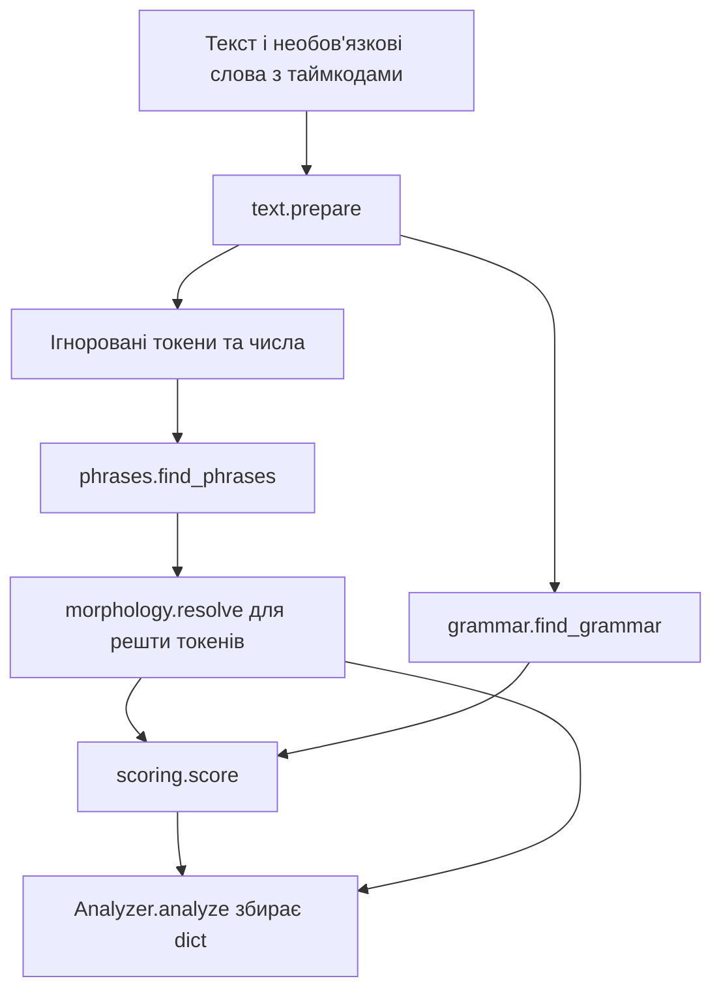

# Аналіз CEFR на рівні коду та методів

Це посібник для розробника, який буде інтегрувати або змінювати аналізатор.
Опис відповідає поточній реалізації. Публічний формат даних зафіксовано
окремо в [контракті v1.0](api-contract.md), джерела — у [sources.md](sources.md).

## 1. Два окремі процеси

**Підготовка даних** виконується через `prepare-data`: адаптери читають сирі
словники й записують робочі артефакти. Мережа використовується тільки за
явного `--download`.

**Аналіз тексту** читає готові локальні словники. Він не завантажує моделі,
не навчається на транскрипціях і не викликає мережу. YouTube-парсер є окремим
етапом перед аналізатором.



## 2. Публічна точка входу: analyzer.py

Код: [analyzer.py](../cefr_analyzer/analyzer.py).

```python
from cefr_analyzer import Analyzer

analyzer = Analyzer()
result = analyzer.analyze(
    text="She turned it down.",
    words={"word": ["She", "turned", "it", "down."],
           "time_code": [0.0, 0.2, 0.5, 0.7]},
)
level = result["assessment"]["level"]
words = result["word_levels"]
```

| Метод/функція | Що робить |
|---|---|
| `Analyzer.__init__(data_dir=DATA, config=None)` | Створює `Lexicon`, зберігає `ScoringConfig` |
| `Analyzer.analyze(text=None, words=None, *, ignore_terms=())` | Виконує весь аналіз і повертає `dict` |
| `analyze(...)` | Допоміжна функція: створює новий `Analyzer` для одного виклику |
| `ignored_indices(tokens, terms)` | Токенізує задані імена/назви й знаходить їхні входження в межах одного сегмента-речення |
| `build_word_levels(tokens, lexical, unknown)` | Будує компактний словник «форма з тексту → CEFR або None» |

Для багатьох текстів повторно використовуйте об'єкт `Analyzer`: функція
`analyze(...)` щоразу заново завантажує словники.

Усередині `Analyzer.analyze()` послідовність така:

1. `prepare()` повертає початковий/відновлений текст і список `Token`.
2. `ignored` містить індекси явно виключених слів, `numbers` — чисел.
3. `excluded = ignored | numbers` передається в пошук фраз.
4. `find_phrases()` повертає збіги та `consumed` — лише індекси компонентів фраз.
5. Цикл по токенах пропускає `excluded | consumed`. Решту обробляє `resolve()`;
   невідомі слова потрапляють у `unknown` без рівня.
6. `find_grammar()` незалежно аналізує всю послідовність. Якщо граматичний
   збіг перетинає `excluded`, він позначається неоднозначним.
7. Розраховуються покриття, `score()` і попередження.
8. Формується відповідь із версією контракту, входженнями, розподілами,
   компактним словником і маніфестом джерел.

`covered` — кількість покритих лексикою токенів, а не кількість збігів:

```python
word_count = len(tokens) - len(excluded)
covered = sum(len(match["token_indices"]) for match in lexical)
coverage = covered / max(1, word_count)
```

Автоматичні та неоднозначні словникові збіги враховуються в покритті,
але можуть не брати участі у скорингу. Тому високе покриття не є точністю CEFR.

## 3. Токени та прив'язка часу: text.py

Код: [text.py](../cefr_analyzer/text.py).

`Token` — внутрішній незмінний `dataclass`, а не тип публічної відповіді.

| Поле | Значення |
|---|---|
| `word` | Нормалізований токен у нижньому регістрі |
| `start`, `end` | Включний початок та виключний кінець у Python-рядку |
| `sentence` | Ідентифікатор сегмента, розділеного пунктуацією |
| `time_code` | Початкове значення таймкоду або `None` |
| `row` | Порядковий номер вихідного рядка або `None` |

| Функція | Поведінка |
|---|---|
| `expand(word, following="")` | Розкриває підтримувані скорочення; повертає кортеж нормалізованих слів |
| `tokenize(text)` | Знаходить Unicode-слова/числа, застосовує `expand`, зберігає вихідні позиції |
| `records_from(words)` | Перетворює DataFrame, словник колонок або список рядків на записи |
| `prepare(text, words=None)` | Перевіряє дані, зіставляє послідовності токенів і прив'язує час |
| `fragment(text, tokens, indices)` | Будує фрагмент із координатами, індексами та таймкодами |

`tokenize()` перевіряє пунктуацію між словами: `. ! ? ; :` збільшують
`sentence`. Звичайний перенос рядка — ні. Це наближене розділення: наприклад,
крапка в абревіатурі може бути прийнята за межу. Відновлення пунктуації немає.

`That's → that, is`. Обидва токени мають той самий вихідний діапазон.
`he's been` розкривається через `has`, інші підтримувані займенникові `'s`
переважно через `is`; довільне визначення значення скорочень не реалізоване.

`prepare()` токенізує і текст, і з'єднані через пробіл рядки таблиці.
Якщо списки `token.word` різні, піднімається `ValueError`. Потім за позиціями
у з'єднаній таблиці визначається вихідний рядок кожного токена. Таймкоди
не інтерпретуються та не використовуються для переставляння слів.

`fragment()` нормалізує пробіли для показу, але координати залишає відносно
вхідного тексту. Кожен рядок таблиці дає не більше одного елемента `time_codes`
в одному збігу, навіть якщо скорочення розкрилося у два токени.

## 4. Словники та рівні: lexicon.py, levels.py

Код: [lexicon.py](../cefr_analyzer/lexicon.py), [levels.py](../cefr_analyzer/levels.py).

`Lexicon.__init__()` читає `lexicon.json.gz`, `forms.json.gz`, `phrases.json`,
`grammar.json`, `manifest.json`. Для виразів будує `phrase_index`:
перше слово → список термінів, які з нього починаються.

| Метод | Результат |
|---|---|
| `Lexicon.evidence(term)` | Докази для терміна або `None`, якщо його немає |
| `Lexicon.has_pos(lemma, pos)` | Чи є така частина мови хоча б в одному записі леми |
| `Lexicon.export(output_dir)` | Окремі JSON за джерелами та рівнями; повертає кількості термінів за мінімальним рівнем |
| `read_json(path)` | Читає звичайний JSON або gzip за розширенням |

`evidence()` обирає мінімальний рівень серед усіх записів терміна. Поле
`automatic=True` встановлюється, тільки якщо **всі записи з цим мінімумом**
автоматичні. `level_conflict=True` означає наявність різних словникових рівнів.
У `sources` залишаються всі записи, включно з невибраними рівнями.

Це не контекстне визначення значення слова. Вищий рівень не підставляється
замість нижчого автоматичного: такий мінімум буде видимий, але за стандартної
конфігурації не пройде `eligible()`.

`levels.py` містить спільну шкалу:

| Функція | Операція |
|---|---|
| `levels_in(value)` | Витягує позначки A1–C2 з рядка |
| `lowest(values)` | Мінімальна знайдена позначка або `None` |
| `number(level)` | A1 → 1, …, C2 → 6 |
| `band(score)` | Округлення до найближчого рівня, половина вгору, обмеження 1–6 |

Наприклад, `B2.1 → B2`, `B1+ → B1`, `B1-B2 → B1` при виборі мінімуму.

## 5. Морфологія: morphology.py

Код: [morphology.py](../cefr_analyzer/morphology.py).

| Функція | Що перевіряє |
|---|---|
| `regular_candidates(word)` | Генерує можливі основи й очікувані POS для регулярних закінчень |
| `candidates(word, lexicon)` | Об'єднує точний запис, відомі форми та регулярні кандидати з відомими лемами |
| `resolve(word, lexicon)` | Вибирає лексичну оцінку, додає спосіб збігу та можливі леми |
| `is_form(word, kind, lexicon)` | Чи існує кандидат потрібного виду з дієслівною лемою |

Регулярні правила охоплюють `-s/-es/-ies`, `-ing`, `-ed`, `-er/-est`:
повернення `e`, усунення подвоєної приголосної, `i → y`, `y → ie`.
Самої наявності закінчення недостатньо: кандидат має бути відомою лемою
з відповідним POS. Новий CEFR за суфіксом не генерується.

`resolve()` сортує варіанти за:

```python
(number(level), automatic, match != "exact")
```

Спочатку нижчий рівень, за рівності — неавтоматичний, потім точний збіг.
Точна словоформа та єдина інфлекційна основа (`priorities/priority`) не
вважаються конфліктом самі по собі. Якщо різних неточних основ кілька,
`ambiguous=True`. Це правило про кандидатів основи, а не вирішення омонімії.

## 6. Вирази: phrases.py

Код: [phrases.py](../cefr_analyzer/phrases.py).

| Функція | Призначення |
|---|---|
| `object_gap(words)` | Допускає займенник або коротку групу, яка починається з означення й не містить заданих блокувальних слів |
| `contiguous(tokens, start, parts, lemmas)` | Суцільна фраза: перший компонент може бути словоформою, решта збігаються буквально |
| `separated(tokens, start, rule, lemmas)` | Двокомпонентна розділювана фраза з об'єктом між компонентами |
| `template_match(tokens, start, rule, lemmas)` | Шаблон із одним внутрішнім слотом `{object}` |
| `find_phrases(text, tokens, lexicon, ignored)` | Збирає кандидатів, усуває перетини й повертає `(matches, consumed)` |

Кандидати впорядковуються за кількістю компонентів (більше спочатку),
початком, кінцем і терміном. Кандидат із уже зайнятими компонентами відкидається.
Це жадібний вибір, а не пошук глобально найкращого розбиття.

Приклад нормалізованих індексів:

```text
She(0) turned(1) it(2) down(3)
phrase.token_indices = [1, 3]
consumed = {1, 3}
```

`it` залишається окремою лексичною одиницею. `fragment` фрази охоплює
`turned it down`, але `word_levels` утворює ключ `turned down` з компонентів.
Граматика може використовувати ті самі слова незалежно від лексичного обліку.

Розірвані фрази й шаблони зі слотом позначаються неоднозначними. Так само
позначаються задані композиційні сполуки та збіги з означенням перед першим
компонентом. Це консервативні евристики: значення фрази не визначається повністю.

## 7. Граматичний розбір: grammar.py

Код: [grammar.py](../cefr_analyzer/grammar.py).

Усі рівні беруться з `lexicon.grammar_rules`, а не з назви конструкції.
Групи допоміжних дієслів, прикметників та службових слів завантажуються через
`load_word_groups()` із `data/grammar_words.json` під час імпорту модуля.
Завантажувач перевіряє списки й повертає `frozenset`; після редагування JSON
потрібно перезапустити процес. `data_dir` об'єкта `Analyzer` не перемикає цей
файл груп: він читається з каталогу даних пакета.

| Функція | Роль |
|---|---|
| `valid(tokens, index, sentence)` | Перевіряє межі списку та той самий сегмент |
| `next_content(tokens, index, sentence)` | Пропускає слова групи `SKIP`, зокрема підтримувані заперечення й прислівники |
| `first_auxiliary(tokens, start, lexicon)` | Визначає початкове допоміжне; обмежено уточнює `'d` як `had` |
| `semi_modal(...)` | Розпізнає `be going to + verb` та `have to + verb` |
| `modal_modifier(...)` | Обробляє `may well`, `may as well`, `might as well` |
| `read_auxiliaries(tokens, start, first)` | Повертає позицію присудка та ознаки perfect/progressive/copular і модифікатор |
| `has_direct_object(tokens, index, lexicon)` | Шукає займенниковий об'єкт або іменниковий кандидат одразу після присудка/одного означення |
| `predicate_kind(tokens, index, lexicon)` | Класифікує присудок як progressive/adjective/passive/predicate й повертає неоднозначність |
| `lexical_verb(word, lexicon)` | Перевіряє дієслівного кандидата |
| `chain_name(...)` | Будує технічний ідентифікатор конструкції |
| `parse_chain(tokens, start, lexicon)` | Координує розбір одного ланцюжка |
| `sourced_match(...)` | Приєднує фрагмент, джерела й рівень правила |
| `find_grammar(text, tokens, lexicon)` | Обходить токени, позначає використані індекси, обробляє infinitive/negative варіанти |
| `find_clause_patterns(text, tokens, lexicon)` | Окремо шукає негативну інверсію та неоднозначних кандидатів Third Conditional |

### Один допоміжний ланцюжок

`read_auxiliaries()` проходить можливі компоненти `modal → have → been/be → being`
з підтримуваними вставками `SKIP`. `parse_chain()` перевіряє присудок і повертає
словник із `end`, `rule`, `ambiguous` та, коли доступні, додатковими ознаками.
`None` означає, що з цієї позиції ланцюжка не знайдено.

`find_grammar()` додає весь діапазон ланцюжка до свого `consumed`, навіть
якщо він невпевнений. Тому `must have been exciting` не створює окремого
Present Perfect Continuous усередині. `consumed` граматики не є набором
`consumed` лексичних фраз — це незалежні проходи.

### Прикметник чи дієслово

Для відомої форми `-ing` у групі `ADJECTIVAL`:

- явний об'єкт → progressive;
- кінець сегмента або задане продовження `CLAUSE_STOPS` → adjective;
- інше продовження → adjective з `ambiguous=True`.

Тому `That's annoying` дає `present_copular`, а `She is annoying me` —
`present_continuous`. Це обмежений контекстний шаблон: повного дерева залежностей
немає, наприклад складний об'єкт із кількома означеннями може бути пропущений.

Відома форма `past_participle` після copular-ланцюжка вважається кандидатом
passive. Якщо форма також словниковий прикметник, збіг неоднозначний;
безпосереднє `by` після неї знімає цей прапорець.

### Рівень та спеціальні випадки

`sourced_match()` шукає точний ключ у `grammar_rules`. За відсутності ключа
повертаються `level=None`, `sources=[]`, `ambiguous=True`. Запис із порожнім
рівнем також не пройде скоринг. Назва складного ланцюжка сама не створює CEFR.

`find_grammar()` має додаткові правила для `to have ...` та варіантів із `not`.
`find_clause_patterns()` шукає Third Conditional лише в обмеженому вікні після
`if`; такий кандидат завжди неоднозначний. Це не повний аналіз умовних речень,
питальної інверсії, relative clauses чи всіх конструкцій із джерела CEFR-J.

## 8. Підрахунок складності: scoring.py

Код: [scoring.py](../cefr_analyzer/scoring.py).

| Функція/клас | Роль |
|---|---|
| `ScoringConfig` | Незмінний dataclass параметрів; `__post_init__` перевіряє пороги й ваги |
| `eligible(match, config)` | Допускає лише відомий рівень, не неоднозначний і дозволений за автоматичністю збіг |
| `distribution(matches)` | Рахує всі відомі рівні без фільтра `eligible` |
| `lexical_profile(content_words, config)` | Повертає числову лексичну оцінку та частки ознак для кожного порога |
| `grammar_profile(structures, word_count, config)` | Повертає граматичну оцінку за частотою й розподілом по вікнах |
| `score(lexical, grammar, word_count, coverage, config)` | Фільтрує докази, об'єднує оцінки й формує `assessment` |

### Фільтр свідчень

```python
words = [m for m in lexical if eligible(m, config)]
content_words = [m for m in words if m["lemma"] not in FUNCTION_WORDS]
structures = [m for m in grammar if eligible(m, config)]
```

`FUNCTION_WORDS` зараз зберігається в `scoring.py`. Він впливає лише на
змістову лексичну частку. Службові слова залишаються в результатах і можуть
входити до `eligible_lexical_units`. Невідомі слова не отримують числової оцінки.

### Лексична оцінка L

Для кожного порога `k` від A2 до C2 збираються одиниці з рівнем `>= k`:

```text
support = кількість входжень
types = кількість різних вибраних lemma
share = support / max(1, кількість content_words)
```

Типові параметри:

| Параметр | Значення | Сенс |
|---|---:|---|
| `lexical_support` | 3 | Мінімум входжень для підвищення |
| `lexical_tail_share` | 0.07 | Частка для A2–B1 |
| `advanced_tail_share` | 0.05 | Частка для B2 |
| `proficient_tail_share` | 0.03 | Частка для C1–C2 |
| `advanced_type_support` | 3 | Мінімум різних лем/виразів для B2–C2 |

`L` — найвищий поріг, що пройшов усі перевірки; початкове значення 1.
Наприклад, 6 входжень B2 з 100 змістових одиниць — це 6%; за трьох різних
лем вони підтримують B2. Ті самі 6 повторень однієї леми не підтримують B2.
Словниковий вираз рахується як одна одиниця, хоча покриває кілька токенів.

### Граматична оцінка G

Для кожного порога `k`:

```text
support = кількість структур рівня k або вище
density = 100 * support / max(1, word_count)
distinct = кількість різних значень token_indices[0] // 50
available = min(3, max(1, ceil(word_count / 50)))

strength = min(1, density / grammar_full_density)
якщо support < grammar_support: strength = 0
strength *= min(1, distinct / available)

G = max(1, 1 + (number(k) - 1) * strength для всіх k)
```

Стандартні `grammar_support=3`, `grammar_full_density=6.0`.
Вікна утворюються за **індексами нормалізованих токенів**, а не реченнями;
`word_count` виключає числа та явні ігнорування. Початкові індекси при цьому
не перенумеровуються. Рідкісний складний збіг не має самостійного впливу.

### Загальний результат та впевненість

```python
S = L + config.grammar_weight * max(0, G - L)
level = band(S)
```

Стандартна вага граматики — `0.75`. Граматика може підвищити лексичну оцінку,
але не знижує її. Наприклад, `L=3`, `G=5` дають `S=4.5`, тобто C1 після
округлення. Це арифметичний приклад, а не гарантія такого результату на тексті.

Якщо всіх надійних лексичних одиниць менше **3**, `score` та `level` дорівнюють
`None` незалежно від граматики. Ця перевірка зараз фіксована в `score()`
і не є значенням `lexical_support` із конфігурації.

`confidence="medium"` установлюється, якщо одночасно:

- `word_count >= 100`;
- `coverage >= 0.9`;
- частка `eligible` серед усіх лексичних збігів не менша за `0.75`.

В інших випадках — `low`. Значення `high` немає. Це евристика достатності
даних, а не оцінена ймовірність правильного CEFR.

## 9. Формування компактного словника

`build_word_levels()` з'єднує `tokens[index].word` для індексів кожного
лексичного збігу. Ключ не береться з `lemma`, тому `turned down` не
перетворюється на `turn down`. У повторних ключах береться нижчий CEFR.
Невідомі входження додаються зі значенням `None`; словник сортується для
зручного показу, але порядок ключів не є вимогою контракту.

`automatic_matches` — підмножина `lexical_matches` з `automatic=True`.
`unknown_words` містить частоти за нормалізованим словом, а
`unknown_occurrences` — усі його входження. `word_levels` не викликає
`eligible()`, тому не слід самостійно усереднювати його значення для рівня тексту.

## 10. Підготовка даних та джерела рівнів: sources.py

Код: [sources.py](../cefr_analyzer/sources.py).

| Функції | Робота |
|---|---|
| `csv_rows`, `json_read` | Читають сирі CSV/JSON, враховуючи UTF-8 BOM |
| `normalize_term`, `add` | Нормалізують термін, перевіряють формат і рівень, прибирають дублікати записів |
| `import_profile` | CEFR-J/Octanove; розділяє альтернативи зі слешами |
| `import_openjam` | Слова, POS і рівні; з'єднання форм через ID; рівні позначає автоматичними |
| `import_mega` | Тільки Word/CEFR; автоматичні рівні |
| `import_gse` | Готовий CEFR, ID, POS; перевірка повноти відповіді та побудова підтримуваних слотів |
| `import_kaikki` | Потоково читає англійські форми JSONL/gzip; CEFR не створює |
| `import_grammar` | Зіставляє ідентифікатори правил із рядками CEFR-J |
| `write_json` | Стабільно серіалізує дані; gzip має `mtime=0` |
| `fetch` | Явно завантажує джерела з проміжним `.part` файлом |
| `build` | Запускає імпорт, збирає маніфест і записує робочі артефакти |

У `GRAMMAR_ROWS` задається відповідність `ім'я правила → ID рядка CSV`.
`import_grammar()` також додає негативні варіанти для рядків із суфіксом `-1`.
Мінімум обирається з `CEFR-J Level`, `Core Inventory`, `EGP`, `GSELO`;
`FREQ*DISP` не використовується для присвоєння рівня. Походження кожного
рівня зберігає ID, колонку, початкову позначку, код і URL.

Додавання рядка до `GRAMMAR_ROWS` саме по собі не створює детектор: код
у `grammar.py` має повернути відповідне ім'я `rule`. Так само новий детектор
без джерела не отримує вигаданого CEFR.

## 11. Парсер, CLI та калібрування

### transcript_parser.py

Мережевий етап описано докладніше в [parser-integration.md](parser-integration.md).
Він повертає `(word_dict, text)`, а не CEFR-звіт.

- `get_video_id()` перевіряє підтримуваний YouTube URL/ID.
- `get_segments_from_youtube()` запитує потрібну мову й перевіряє метадані.
- `get_segments_from_serpapi()` робить fallback із ротацією ключів і перевіркою мови.
- `clean_text()` очищає субтитри та декодує HTML-сутності.
- `prepare_segments()` перевіряє часові інтервали й стабільно сортує сегменти.
- `make_word_dict()` розбиває очищені сегменти на фрагменти й інтерполює час.
- `get_transcript()` координує отримання та збирає текст з тих самих елементів,
  що й таблиця, без крапок на межах субтитрів.

Таймкоди приблизні. Базовий аналізатор не визначає мову автоматично й очікує,
що попередній етап передає саме англійський текст.

### cli.py

`parser()` задає аргументи. `load_words()` читає CSV/JSON. `run_analysis()`
створює `Analyzer`, викликає аналіз і показує короткий звіт або повний JSON.
`main()` маршрутизує `analyze`, `prepare-data`, `export-dictionaries`, `calibrate`.
Оброблені помилки завершують CLI кодом 2. API при цьому піднімає винятки.

### calibration.py

`filename_label()` знаходить мітку в назві файла та відхиляє конфліктні мітки.
`evaluate()` читає файли, викликає той самий `Analyzer.analyze()`, зберігає
прогнози, параметри, SHA-256 текстів і метрики. `metrics()` рахує точні збіги,
MAE у ступенях CEFR та частку результатів у межах одного ступеня.
Входження без передбаченого рівня виключаються з цих метрик; `evaluated`
може бути меншим за кількість прикладів. Мітка використовується тільки для
порівняння після аналізу, не для визначення результату.

Команда не навчає модель і не змінює пороги автоматично:

```bash
python -m cefr_analyzer calibrate --output reports/calibration_report.json
```

## 12. Налагодження й безпечне розширення

Для неправильного результату перевіряйте по черзі:

1. `text.prepare()` — чи збігаються слова, пунктуація, таймкоди та індекси.
2. `lexical_matches` — чи правильно знайдено вираз/лему та який мінімум джерел вибрано.
3. `ambiguous`, `automatic` — чи не відкинуті важливі свідчення.
4. `grammar_matches` — чи правильний цілий ланцюжок і чи існує джерело правила.
5. `assessment.lexical_tails` — кількість, частка й кількість різних лем для порога.
6. `assessment.grammar_tails` — частота й розподіл по вікнах.
7. `assessment.config` — фактичні параметри цього запуску.

Нове правило перевіряйте на позитивному прикладі та схожому негативному.
Для граматики окремо перевіряйте одиничне й часте вживання, неоднозначність,
відсутність вкладеного повторного підрахунку та переноси між словами.
Покращення розпізнавання не має змінювати [контракт відповіді](api-contract.md).

| Перевірки | Файл |
|---|---|
| Лексика, морфологія, граматика, скоринг, імпорт, CLI | [test_analysis.py](../tests/test_analysis.py) |
| Публічні поля, типи, сигнатури, JSON і таймкоди | [test_contract.py](../tests/test_contract.py) |
| Провайдери → парсер → аналізатор, розриви, Unicode, мова | [test_parser_integration.py](../tests/test_parser_integration.py) |

```bash
python -m unittest discover -s tests -v
python -m cefr_analyzer analyze --text "That's annoying. She is annoying me." --json
```

Числовий рівень тут є евристикою, а не доведеним виміром знання мови.
Поточні обмеження та фактичні результати зберігаються в
[reports/synthetic-results.md](../reports/synthetic-results.md).
